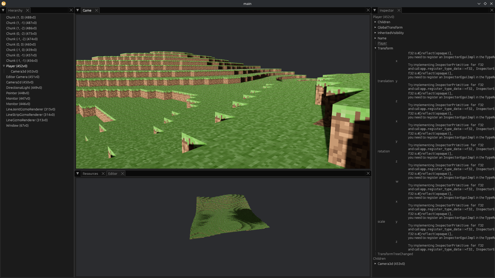

> Give a man a voxel, and you feed him for a day. Teach a man to voxel, and you feed him for a lifetime.

# Learn to build a voxel game with Rust & Bevy



There's no shortage of voxel tutorials, so why write another one?
Because I don't want this to be just a recipe to follow.
It's easy to copy someone else's code and get the same result, but that doesn't necessarily teach you how to build or adapt it yourself.
If you've tried making a voxel game before, you might have come across the tutorials by _b3agz_.
I mention him because he describes very well the problem of many tutorials ([_This Channel is Dead_](https://youtu.be/g0V1JM9P4z8)).
There's a difference between _showing_ someone how to do something and _teaching_ them how to do it.
I want these guides to do the latter: explain the ideas behind the code, help you understand the choices we're making, and give you room to work things out for yourself.
The goal is for you to leave with the skills to keep building, not with a project that only works as long as I keep writing and you keep following along.
I deliberately won't provide complete code snippets.
That means more effort on your part, but it should ultimately help you understand your code.

We won't focus solely on making a perfect voxel engine from start to finish.
It gives us room to explore more than just generating a world of blocks.
Along the way, we'll build a telemetry web server, learn how simplex noise works, create an editor, and more.
We could use libraries, of course, but there's a lot of satisfaction in understanding something well enough to build it yourself.
If all you want is a voxel world, you could use a library like [bevy-voxel-world](https://crates.io/crates/bevy_voxel_world).

I'm no Bevy or game-design professional, so don't expect everything here to be optimal, if even correct.
Bevy is a fast-moving target, so code might be out of date, and some solutions might not follow established Bevy conventions.
Treat this guide as a starting point, and feel free to suggest improvements in a GitHub issue.
If you find the guide useful, please star the repository so I know to keep working on it.

Before starting, I recommend reading the [Bevy introduction](https://bevy.org/news/introducing-bevy).
It's a little outdated, but it explains the core ideas well.
In particular, the _Entity Component System_ (ECS) is an important concept, as it lies at the core of everything Bevy does.

>  Note: This guide is still a hot piece of garbage. Only the first five chapters are done in terms of content, but a lot of writing is still in progress.

## Chapters

- [Setting the scene](docs/chapter01.md)
- [Inspecting settings](docs/chapter02.md)
- [The first mesh](docs/chapter03.md)
- [Creating a chunk](docs/chapter04.md)
- [Multiple chunks](docs/chapter05.md)
- [Multiple voxel types](docs/chapter06.md)
- [Creating a player character](docs/chapter07.md)
- [Breaking and placing blocks](docs/chapter08.md)
- [Terrain generation](docs/chapter09.md)
- [Generating the world](docs/chapter10.md)
- [Performance debugging](docs/chapter11.md)
- [Editor and refactoring](docs/chapter12.md)
- [Phase'd chunk generation](docs/chapter13.md)

---

To run a specific chapter, adjust `path = "src/chapter01.rs"` in `Cargo.toml`, then:

```bash
cargo run
```

To see what changed between chapters, run:

```bash
git diff --no-index src/chapter01.rs src/chapter02.rs
```
