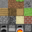

# The first mesh

I hope you're warmed up, because this is where the real work starts.
In this chapter we are going to manually generate the mesh for a voxel, rather than using Bevy's built-in `Cuboid` primitive.
In a real voxel game, we don't want to create a separate cuboid for every voxel.
Instead, we want to combine the visible faces of many voxels into a single mesh for each chunk.

When our game has hundreds, or even thousand of voxels, we don't want to spawn a cuboid for every single voxel.
First, this would mean that we generate a lot of faces for voxels that we can't even see.
Second, graphics cards are not optimized for rendering on many small meshes, scattered throughout memory.
They are much better at operating on large, contiguous blocks of data, which is why we want to combine many voxels into a single mesh.
This groups the different data of each voxel by type and puts them next to each other in memory, which is much more efficient for the GPU to process.

## Visualizing meshes

We can visualize the so-called _wireframe_ of a mesh by drawing lines between the vertices of each triangle.
In Bevy, we can do this by adding the `WireframePlugin` to our app.
Then, we insert the configuration globally for all meshes:

```rust
WireframeConfig {
    global: true,
    ..default()
}
```

Run the game, and see what the mesh looks like.
Use the inspector to adjust the scale of the cube, and observe how the wireframe changes.
Then, replace the cube with a `Sphere`, or some other shape, and see how the wireframe looks for that shape.

## But what even is a mesh?


Essentially, a mesh just defines the shape of a 3D object.
This shape is broken up into polygons (triangles), that together form the surface of the shape.
We use triangles because they are the simplest 2D shape, making them the easiest to work and compute with.

In its simplest form, a mesh consists of a list of _vertices_ and a list of _indices_.
The vertices define the corners of the triangles in the mesh.
Each 3-tuple in the list of indices tells which three vertices form a triangle.

To make a triangle, we need three vertices and three indices.
The triangle is then formed by connecting the three vertices in the order specified by the indices.
Say, we have the following vertices: $v_0 = (0, 0)$, $v_1 = (1, 0)$, and $v_2 = (0, 1)$.

```text
| v2
|
|
| v0   v1
+—————————
```

If the indices are `[0, 2, 1]`, then the triangle is formed by connecting $v_0$ to $v_2$, $v_2$ to $v_1$, and $v_1$ back to $v_0$.

```text
| v2            | v2            | v2
|  |            |  | \          |  | \
|  |            |  |  \         |  |  \
| v0   v1       | v0   v1       | v0———v1
+—————————      +—————————      +—————————
```

A square has four corners, but because we can only make triangles, we need to split it into two triangles, resulting in $2 \times 3 = 6$ indices.
However, these two triangles share two vertices, meaning we only need four vertices.
In the previous example, that would mean adding a fourth vertex $v_3 = (1, 1)$ and extending the indices to `[0, 2, 1, 1, 2, 3]`.

### Winding order

The order in which we create a triangle matters.
In the previous example, we created a triangle in a clockwise order.
In a counter-clockwise order, the indices would be `[0, 1, 2]`.

This distinction matters: we typically only render one side of a triangle.
We normally don't see the inside of a mesh anyway, so why would we bother rendering both sides.
However, that means we need to be careful about the order in which we create triangles, or some of them might seem invisible.
(Using the wireframe view can help you find these kinds of errors.)

By default, Bevy uses a [counter-clockwise](https://docs.rs/bevy/latest/bevy/mesh/struct.Mesh.html) winding order.
That means the example from before would be invisible, because the triangle is facing the wrong way.
Instead, we should create the square from the indices `[0, 1, 2, 2, 1, 3]`.

### Combining faces into a cube

To create a cube, we need to combine six square faces.
Just like how we reused two vertices for making a face, you might think we can also reuse each vertex across its three adjacent faces.
However, a vertex contains more data than just its position.
Another attribute that is relevant now are _normals_.

The normal of a vertex is a vector that points perpendicular to the surface of the mesh at that vertex.
It describes which way the surface is facing, which is used for lighting calculations to determine how light interacts with the surface.

In the case of a cube, each normal points along one of the axes.
That is, the four normals of the right face point along positive x: $(1, 0, 0)$.
If we were to use the same vertex for three adjacent faces, averaging the normals, the normal would point diagonally outward, resulting in a smooth shading across the cube's edges.
To avoid this, we have to give each face its own set of normals, which gives the cube its sharp edges.

### Texture coordinates

For the same reason we want to bundle our meshes together, we typically also want to combine multiple textures into a single image.



UV coordinates associate each vertex with a position in a 2D texture.

```text
  (0, 0) +———————————————+ (1, 0)
         | Stone | Dirt  |
         |       |       |
(0, 0.5) |———————+———————| (1, 0.5)
         | Wood  | Log   |
         |       |       |
  (0, 1) +———————————————+ (1, 1)
```

### Putting it all together

Our voxel has six faces, each consisting of two triangles.
This gives our voxel a total of $6 \times 4 = 24$ vertices, $6 \times 2 \times 3 = 36$ indices, $6 \times 4 = 24$ normals, and $6 \times 4 = 24$ UV coordinates.

---

## Building the mesh

We now have the concepts needed to generate our cube:

- **Positions** describe where the vertices are.
- **Indices** describe which vertices form each triangle.
- **Normals** describe which way the surface faces for lighting.
- **UV coordinates** describe how a texture maps onto the surface.

Each face contributes four vertices, six indices, four normals, and four UV coordinates.
We generate these values for each of the six directions and append them to the corresponding arrays.

```text
             Cube
               |
      +--------+--------+
      |        |        |
    Right     Left     Top
      |        |        |
      +--------+--------+
               |
         Bottom, Front,
             Back
               |
               v
        Mesh attributes
               |
               v
            Bevy Mesh
```

For our cube, the arrays contain:

| Attribute | Number of entries |
|---|---:|
| Positions | 24 |
| Indices | 36 |
| Normals | 24 |
| UV coordinates | 24 |

You might wonder why we store 24 vertices when a cube has only eight unique corners.
Each face needs independent surface attributes.
For example, the top and front faces have different normals at their shared corner, so they need separate vertices.

More generally, a vertex is a complete set of attributes, not just a position.
Two vertices can occupy the same point in space while still being different vertices because their normals, UV coordinates, or other attributes differ.

Once we've generated the arrays, we create a Bevy `Mesh`, specify that it uses a triangle list, and insert the attributes and indices.

`PrimitiveTopology::TriangleList` tells Bevy to interpret each group of three indices as a triangle.
`RenderAssetUsages` controls where mesh data is retained for rendering and asset access; you can refer to the [Bevy documentation](https://docs.rs/bevy/latest/bevy/asset/struct.RenderAssetUsages.html) for details.

You don't need to memorise every Bevy API involved.
What matters is understanding the data we're constructing and how the pieces relate to each other.
The API is simply how we express these concepts in Bevy.

## Rendering the mesh

We can now replace Bevy's built-in `Cuboid` with our generated mesh.
The entity still has a transform and a material; only the source of its geometry changes.

Since we've generated the vertices directly in the range from zero to one, we don't need a separate voxel position or a translation to place the mesh.
It already sits at the world origin.

Run the game.
The result should look much like it did before, even though we're now generating the geometry ourselves.

Try changing the vertex positions, adjusting the normals, or changing the UV coordinates.
Observe how each change affects the result.
Reversing the winding order is also a useful experiment: it demonstrates why triangle orientation matters.

When a mesh looks wrong, ask yourself which part of its data is responsible:

- Is the geometry in the right place?
- Are the indices connecting the intended vertices?
- Are the triangles facing the right way?
- Are the normals correct?
- Are the UV coordinates mapped as intended?

This way of reasoning applies to almost any mesh you generate.

## What's next?

We've generated a mesh for a single voxel, but we're still creating all six faces, regardless of whether they're visible.

Place two voxels next to each other and the faces between them are hidden.
We don't need to render those faces, yet our current approach would generate them anyway.

The next step is to generate a mesh from multiple voxels, skipping faces that are covered by neighbouring voxels.
This will give us the foundation for chunk meshes, where we combine many voxels into one mesh and avoid generating geometry that the player can never see.
